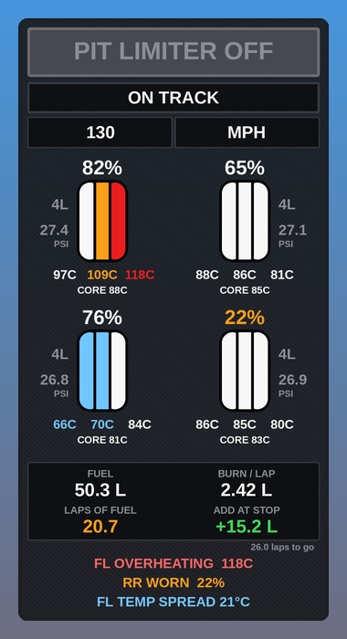

# Pitbox Helper

Pit, tyre and fuel overlay for Assetto Corsa. It's a Custom Shaders Patch Lua app.

## What it does

- **Pit limiter.** Shows whether the limiter is on. It flashes red if you're in the pit lane with it off.
- **Status.** Shows ON TRACK, PIT LANE, IN BOX or BOX THIS LAP.
- **Pit speed.** In the pit lane it shows your speed over the limit.
- **Tyres.** For each tyre you get:
  - wear remaining (%)
  - inner, middle and outer temps, plus core temp
  - pressure
  - laps on the current set
- **Tyre colours.** Each tread zone is coloured: blue is cold, white is in the window, amber is warm and red is overheating.
- **Fuel.**
  - Burn per lap is averaged over your last 5 laps.
  - Laps of fuel shows how far your tank will take you.
  - Fuel to add at the stop covers the rest of the race plus a margin.
- **Warnings.**
  - hot, cold or overheating tyres
  - a big spread between inner and outer temps
  - worn tyres
  - hot brakes
  - low fuel

## Install

1. Download the repo as a zip (Code → Download ZIP), or grab the zip from Releases.
2. Drag it onto Content Manager and click Install.
   Or copy `apps/lua/PitboxHelper` into `<Assetto Corsa>/apps/lua/`.
3. In game, turn it on from the app bar on the right.

You need [Custom Shaders Patch](https://acstuff.club/patch/).

## Settings

Open settings from the cog on the app bar.

- Units: °C or °F, km/h or mph, psi or bar. It defaults to °C.
- Tyre optimum temp. It reads this from the car, or you can set it yourself.
- Temp window, which defaults to ±12 °C.
- Wear and brake warning levels.
- Race length, taken from the session or set yourself.
- Fuel margin.

## Notes

- Race length is read from the session. For a lap race it uses the lap count. For a timed race it uses time left divided by your lap time.
- Not every car reports brake disc temps or a tyre optimum temperature. If a car doesn't, the brake warning is skipped and the temp window falls back to 85 °C.
